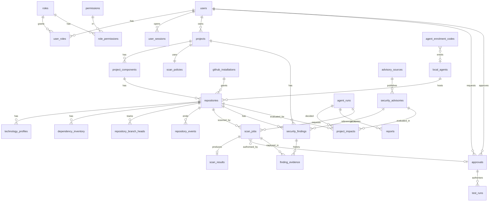

# Database Schema

Status: Phase 0 draft, awaiting approval. Engine: PostgreSQL. ORM: SQLAlchemy 2 (async). Migrations: Alembic.

## 1. Conventions

- Primary keys: `id UUID` (generated server-side).
- Every table: `created_at timestamptz not null default now()`, `updated_at timestamptz not null default now()` (updated by trigger), except `audit_logs` which has `at` only and is never updated.
- Status and kind columns are Postgres enums.
- Foreign keys declared with explicit `ON DELETE` behaviour (mostly `RESTRICT`; history tables never cascade-delete).
- JSONB only for genuinely variable data: scanner summaries, affected version ranges, patched versions, approval scope, approved roots, references, agent output, policy conditions.
- Secret-bearing columns end in `_enc` and hold envelope-encrypted bytes. No column holds a raw secret.

## 2. Enums

| Enum | Values |
| --- | --- |
| `project_status` | active, paused, incident, archived |
| `criticality` | critical, high, medium, low |
| `component_kind` | web, api, mobile_ios, mobile_android, flutter, game, infra, other |
| `repo_source` | github, local |
| `scanner` | osv_scanner, npm_audit, pip_audit, semgrep, codeql, gitleaks, trivy, integrity |
| `scan_trigger` | schedule, webhook, advisory, manual |
| `scan_status` | queued, running, succeeded, failed, partial, skipped_unchanged, cancelled |
| `severity` | critical, high, medium, low, informational |
| `confidence` | confirmed, high, medium, low, needs_verification |
| `finding_status` | open, in_progress, resolved, accepted_risk, false_positive |
| `impact_classification` | confirmed_affected, potentially_affected, not_affected_on_evidence, needs_verification, not_scanned |
| `repo_event_kind` | force_push, history_rewrite, lifecycle_script_change, workflow_change, vscode_task, ide_config_change, build_config_change, suspicious_file, ignored_file_committed |
| `approval_status` | pending, approved, rejected, expired, executed, failed |
| `agent_run_status` | running, succeeded, failed, timed_out |
| `report_status` | draft, approved |
| `note_status` | draft, approved, rejected |
| `actor_type` | user, agent, system |
| `policy_tier` | allowed, approval_required, forbidden |
| `source_trust` | vendor, ghsa, osv, nvd, cisa_kev, ecosystem |

## 3. Tables

### Access

**users** — `email` (unique, citext), `password_hash` (argon2id), `totp_secret_enc`, `is_active`, `last_login_at`.

**roles** — `name` (unique: admin, approver, developer, viewer).

**permissions** — `action`, `resource`; unique (`action`, `resource`).

**user_roles** — `user_id` FK, `role_id` FK; PK (`user_id`, `role_id`).

**role_permissions** — `role_id` FK, `permission_id` FK; PK (`role_id`, `permission_id`).

**user_sessions** *(addition)* — `user_id` FK, `token_hash` (unique), `expires_at`, `revoked_at`, `ip`, `user_agent`. Server-side sessions so they can be revoked.

### Registry

**projects** — `name`, `slug` (unique), `description`, `owner_user_id` FK users, `criticality`, `status`, `deployment_environments` (text[]), `llm_allowed` bool default true *(addition, pending OQ-6)*.

**project_components** — `project_id` FK, `kind`, `name`; unique (`project_id`, `name`).

**repositories** — `component_id` FK, `source`, `github_installation_id` FK nullable, `github_repo_id` bigint nullable, `full_name` nullable, `local_agent_id` FK nullable, `local_path_alias` nullable, `default_branch`, `manifest_hash`, `tree_hash`, `last_inventory_at`.
- CHECK: `source = 'github'` requires `github_repo_id`; `source = 'local'` requires `local_agent_id` and `local_path_alias`.
- Unique (`github_repo_id`) where not null; unique (`local_agent_id`, `local_path_alias`) where not null.

**repository_branch_heads** *(addition)* — `repository_id` FK, `branch`, `head_sha`, `observed_at`; unique (`repository_id`, `branch`). Used to detect history rewrites.

**technology_profiles** — `repository_id` FK, `ecosystem`, `framework`, `version`, `package_manager`, `lockfile_path`, `detected_at`.

**dependency_inventory** — `repository_id` FK, `ecosystem`, `package`, `version`, `direct` bool, `manifest_path`, `manifest_hash`. Index (`ecosystem`, `package`) for advisory matching. Rebuilt per repository on manifest change, in one transaction.

**github_installations** *(addition)* — `installation_id` bigint unique, `account_login`, `account_type`, `permissions` (JSONB snapshot), `suspended_at`.

**local_agents** — `name`, `host_fingerprint`, `public_key` (Ed25519, raw 32 bytes), `approved_roots` (JSONB list of `{alias, path}`), `last_seen_at`, `revoked_at`, `os`, `agent_version`.

**agent_enrolment_codes** *(addition)* — `code_hash` unique, `created_by` FK users, `expires_at`, `used_at`, `local_agent_id` FK nullable.

**scan_policies** — `project_id` FK unique, `daily_deps`, `daily_secrets`, `weekly_full`, `webhook_targeted` (bools), `codeql_enabled` bool default false.

### Scanning

**scan_jobs** — `repository_id` FK, `scanner`, `trigger`, `inventory_hash`, `status`, `started_at`, `finished_at`, `error`, `approval_id` FK nullable, `requested_by_run_id` FK agent_runs nullable.
- Partial unique index on (`repository_id`, `scanner`, `inventory_hash`) where `status in ('queued','running')` — deduplication.

**scan_results** — `scan_job_id` FK unique, `raw_report_path` (file on disk, not in DB), `raw_report_sha256`, `summary` (JSONB), `coverage` (JSONB: what was and was not scanned).

### Findings

**security_findings** — `fingerprint` (unique), `project_id` FK, `repository_id` FK, `scanner`, `rule_id`, `category`, `title`, `severity`, `confidence`, `status`, `file_path`, `line`, `package`, `package_version`, `advisory_id` FK nullable, `first_seen_at`, `last_seen_at`, `resolved_at`, `resolved_by_scan_job_id` FK nullable, `triage_note`.
- Indexes: (`project_id`, `status`, `severity`), (`repository_id`, `scanner`, `status`).

**finding_evidence** — `finding_id` FK, `scan_job_id` FK, `evidence_redacted` (text), `match_hash` (for secrets: HMAC-SHA256 with platform salt), `commit_sha`, `captured_at`. Full history kept; never deleted.

### Intelligence

**advisory_sources** — `name`, `url`, `kind`, `trust_level` (`source_trust`), `active` bool, `last_polled_at`, `etag`/`cursor`.

**security_advisories** — `source_id` FK, `external_id` (CVE / GHSA / OSV ID), `aliases` (text[]), `title`, `url`, `ecosystem`, `package`, `affected_ranges` (JSONB), `patched_versions` (JSONB), `severity`, `cvss_vector`, `known_exploited` bool, `vendor_facts` (text), `ai_interpretation` (text, nullable), `extra_conditions` (JSONB, nullable), `published_at`, `modified_at`, `retrieved_at`.
- Unique (`source_id`, `external_id`). Index (`ecosystem`, `package`).

**project_impacts** — `advisory_id` FK, `repository_id` FK, `classification`, `reasoning`, `evidence` (JSONB list of finding/inventory IDs), `references` (JSONB list of advisory/source IDs), `decided_by_rule` (text nullable), `decided_by_run_id` FK agent_runs nullable, `decided_at`.
- Unique (`advisory_id`, `repository_id`) — latest decision; previous decisions retained in `agent_runs.output` and audit.

### Integrity

**repository_events** — `repository_id` FK, `kind`, `before_sha`, `after_sha`, `ref`, `detail` (JSONB, redacted), `severity`, `source` (webhook / scan), `delivery_id` nullable.

**webhook_deliveries** *(addition)* — `delivery_id` (unique), `event`, `received_at`, `processed_at`, `status`. Idempotency on `X-GitHub-Delivery`.

### Control

**policies** *(addition — backs the PolicyEngine)* — `action` (tool or operation name), `tier` (`policy_tier`), `conditions` (JSONB), `description`, `active`. Deny by default when no active row matches.

**approvals** — `action`, `scope` (JSONB, canonical), `scope_hash` (SHA-256), `reason`, `risks`, `requested_by` FK users, `requested_by_run_id` FK nullable, `status`, `approver_id` FK users nullable, `decided_at`, `expires_at`, `executed_at`, `result` (JSONB).
- CHECK: `approver_id is null or approver_id <> requested_by`.
- Index (`status`, `expires_at`).

**agent_runs** — `agent_name`, `input_hash`, `input` (JSONB, redacted), `output` (JSONB), `model` nullable, `tokens_in`, `tokens_out`, `tool_calls` int, `status`, `error`, `started_at`, `finished_at`, `project_id` FK nullable.

**test_runs** — `approval_id` FK, `target_url`, `tool`, `status`, `report_path`. (Later phase.)

### Output

**reports** — `kind`, `scope` (JSONB), `status` (`report_status`), `file_path`, `generated_by_run_id` FK, `approved_by` FK users nullable, `approved_at`.

Learning Notes was removed from scope by the user on 2026-11-25. No `learning_notes` table exists or is planned.

### Audit

**audit_logs** — `actor_type`, `actor_id`, `action`, `target_type`, `target_id`, `outcome`, `ip`, `detail` (JSONB, redacted), `at`.
- Application role: `GRANT INSERT, SELECT`. No `UPDATE`, `DELETE`, `TRUNCATE`.
- `BEFORE UPDATE OR DELETE OR TRUNCATE` trigger raises an exception.
- Index (`at`), (`actor_type`, `actor_id`), (`target_type`, `target_id`).

## 4. Database roles

| Role | Rights |
| --- | --- |
| `platform_owner` | Owns schema; used only by Alembic migrations. |
| `platform_app` | CRUD on application tables; `INSERT, SELECT` on `audit_logs`; no DDL. Used by api and worker. |
| `platform_readonly` | `SELECT` for backups and reporting. |

## 5. Lifecycle rules

- **Fingerprint** (unique): SHA-256 of `repository_id | scanner | category` plus category-specific stable fields
  (implemented in `apps/api/app/scanners/base.py`). The scanner is always included (changed in Phase 3 from the Phase 0
  draft) so that "resolved" always means *the same scanner* stopped reporting it; cross-scanner de-duplication is a
  display concern for Phase 5.
  - dependency: `package | first advisory ID | lockfile path` (version excluded so an upgrade to another vulnerable version keeps the same finding);
  - code: `rule_id | file_path | normalised-snippet hash` (stable across line shifts);
  - secret: `rule_id | file_path | match_hash`;
  - integrity and misconfiguration: `rule_id | file_path | line`.
- **Reopen:** a resolved finding that is reported again goes back to `open`.
- Repeated detection: update `last_seen_at`, insert `finding_evidence`. Nothing is silently discarded.
- **Resolution:** a finding moves to `resolved` only after a `succeeded` scan job of the same scanner on the same repository, whose coverage includes the finding's file or package, no longer reports it. `failed`, `partial` and `skipped_unchanged` jobs never resolve anything.
- `accepted_risk` and `false_positive` require an approver and a note; both are audited.
- **Scan dedup:** see partial unique index on `scan_jobs`.

## 6. Entity relationships

`audit_logs`, `policies`, and `webhook_deliveries` reference other rows by typed ID in JSON/text and are omitted from the diagram for readability.

## 7. Additions beyond the master prompt table list

These tables are needed by rules the master prompt already sets. Listed for explicit approval:

| Table | Needed for |
| --- | --- |
| `policies` | PolicyEngine "backed by Postgres" (R2). |
| `user_sessions` | Revocable sessions. |
| `github_installations` | GitHub App install flow. |
| `agent_enrolment_codes` | One-time local-agent enrolment codes. |
| `repository_branch_heads` | History-rewrite detection from stored branch heads. |
| `webhook_deliveries` | Idempotency on `X-GitHub-Delivery`. |

### Phase 2 additions (migration `0002_registry`)

| Table / column | Needed for |
| --- | --- |
| `github_installation_repos` | Repositories visible to each installation; a repository can only be registered if listed here and its installation is read-only and not suspended. |
| `github_installations.read_only` | Recomputed from GitHub's permission map on every install and `installation` webhook; anything but `read` blocks token minting. |
| `local_agent_challenges` | Single-use, 120-second nonces for Ed25519 challenge-response (consumed even when the signature fails). |
| `local_agent_sessions` | Short-lived (15 min) agent bearer tokens, stored as hashes; revoked with the agent. |
| `repositories.inventory_complete`, `inventory_coverage` | `NULL` = never inventoried ("not scanned"); `false` = partial (unparsed lockfile, unresolved ranges, truncated tree). Impact analysis must not treat a partial inventory as evidence of absence. |
| `dependency_inventory.version_spec` | Declared range when no lockfile resolves the version. |
| `technology_profiles.directory` | One repository can hold several ecosystems in different folders (monorepos). |

Grants: `repository_events` is `SELECT, INSERT` only for the app role; `technology_profiles` and `dependency_inventory` allow `DELETE` because each inventory replaces the previous one; no Phase 2 table grants `DELETE` otherwise.
