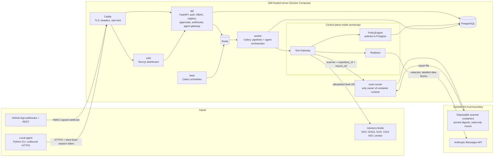

# System Architecture

Status: Phase 0 draft, awaiting approval.
Sources: `Agentic AI Security Platform Architecture and Roadmap.pdf`, `MASTER_PROMPT.md`.

## 1. Purpose

A self-hosted platform that watches 15 to 20 company projects (mixed stacks) and tells each owner which project needs attention and why. It reads, scans, correlates and reports. It never changes code, dependencies, credentials, permissions or deployments.

## 2. Fixed decisions

| Decision | Value |
| --- | --- |
| Architecture | Hybrid: central server + local agents. Deterministic pipelines detect; LLM agents run only at named steps. |
| Project access | GitHub App (read-only) and a Python local agent for administrator-approved folders. |
| Deployment | One self-hosted Linux server, Docker Compose. |
| First priority | Security monitoring. |
| Human approval | Mandatory for anything outside the read-only tier. Enforced in backend code. |

## 3. Design principles

1. **Evidence before opinion.** Scanners and advisories produce evidence. Claude explains, correlates, prioritises and drafts. Claude never declares code vulnerable or safe without scanner or advisory evidence.
2. **Controls before capability.** PolicyEngine, Tool Gateway, redactor, audit log and approvals exist before any agent can call a tool.
3. **Enforced in code, not in prompts.** Prompts restate policy only as a courtesy.
4. **Untrusted by default.** Repository content, commit messages, issues, scanner output and web pages are data. They never change policy, permissions or tool lists.
5. **Honest results.** A failed or partial scan is never a clean result. "Not scanned" is different from "no findings".
6. **Least privilege everywhere.** Read-only GitHub App, read-only mounts, no Docker socket outside `scan-runner`, append-only audit.

## 4. Component overview

### 4.1 Services

| Service | Responsibility | Never does |
| --- | --- | --- |
| `caddy` | Public TLS on 443, security headers, rate limit on `/api/webhooks/*` and `/api/agents/*`. | Hold application secrets. |
| `web` | Next.js App Router dashboard (TypeScript, SCSS modules, PrimeReact). Talks only to `api`. | Talk to Postgres, Redis or GitHub directly. |
| `api` | FastAPI: auth (argon2 + TOTP), RBAC, project registry, GitHub App webhooks, local-agent gateway, approvals, reports, audit. | Start containers, call Claude. |
| `worker` | Celery tasks: discovery, inventory, scan orchestration, advisory ingestion, impact analysis, report drafts. Hosts the agent orchestrator, Tool Gateway, PolicyEngine and redactor. | Mount the Docker socket, run project code. |
| `beat` | Celery schedules only. | Anything else. |
| `scan-runner` | Receives `{scanner, repository_id, mount_ref}`, starts a pinned image with a fixed argument template, enforces limits and network, returns the report file, deletes the container. | Accept an image not in `images.lock`, accept free-form arguments. |
| `postgres` | System of record. | Publish a port. |
| `redis` | Celery broker and result backend, short-lived rate-limit counters. | Publish a port, store secrets. |

### 4.2 Code modules (inside `apps/api/app`)

- `core/` — settings, logging (structured JSON), security primitives, PolicyEngine.
- `db/` — SQLAlchemy 2 async models, session, Alembic migrations.
- `modules/` — `auth`, `rbac`, `projects`, `components`, `repositories`, `local_agents`, `github_app`, `scans`, `findings`, `advisories`, `impacts`, `approvals`, `reports`, `audit`.
- `agents/` — orchestrator, agent specs, Tool Gateway, tool implementations, prompts.
- `scanners/` — one adapter per scanner: argument template + parser to the normalised `Finding` model.
- `integrations/` — GitHub App client, local-agent API, advisory feed clients.
- `workers/` — Celery app, tasks, schedules.

## 5. Trust boundaries

| Zone | Trust | Contents |
| --- | --- | --- |
| Operators | Authenticated, role-scoped | Dashboard users (admin, approver, developer, viewer). |
| Server core | Trusted code, untrusted data | api, worker, beat, postgres, redis. |
| scan-runner | Privileged, minimal surface | The only service that can start containers. |
| Scanner containers | Untrusted | Run pinned third-party tools over untrusted project files. |
| Local agents | Semi-trusted, revocable | Run on developer machines and servers; identity is an Ed25519 key. |
| GitHub | External, authenticated | Webhooks verified by HMAC; API via short-lived installation tokens. |
| Anthropic API | External | Receives only redacted, labelled data. No project source files. |
| Advisory feeds | External, untrusted content | Allowlisted URLs only; content treated as data. |

## 6. Key data flows

### 6.1 Push webhook to finding

1. GitHub sends `push` to `/api/webhooks/github`.
2. `api` verifies `X-Hub-Signature-256` (constant-time compare), rejects duplicates by `X-GitHub-Delivery`, applies a per-repository rate limit, writes `repository_events` (`forced: true` becomes a `force_push` event), and queues work.
3. `worker` recomputes `manifest_hash` and `tree_hash` for changed paths.
4. If the manifest changed, the worker asks the Tool Gateway for `run_osv_scanner`. The PolicyEngine allows it (read-only tier) and writes an audit row.
5. `scan-runner` fetches the repository into an ephemeral volume, starts the pinned OSV-Scanner image with the lockfile-only template, collects the JSON report, deletes the container and volume.
6. The adapter parses the report into findings with fingerprints. New fingerprints insert; known fingerprints update `last_seen_at` and add `finding_evidence`.
7. Integrity checks run on the diff (see `SCANNING_STRATEGY.md` §6).
8. If a finding matches a stored advisory, the Impact Analysis agent asks Claude to explain the match using redacted evidence and writes `project_impacts`.

### 6.2 Local agent scan

1. An admin creates a one-time enrolment code and the approved roots for that machine (server-side).
2. `security-agent register` generates an Ed25519 key pair, stores the private key in the OS keychain and sends the public key with the code.
3. The agent obtains short-lived session tokens by signing a server challenge.
4. The agent pulls jobs, resolves real paths inside approved roots only, detects technologies, parses manifests and lockfiles locally, and runs only allowlisted scanner binaries with fixed arguments.
5. It uploads structured results (dependency list, findings with redacted evidence). It never uploads `.env*`, key files or content matching secret patterns.

### 6.3 New advisory to impact

1. `beat` triggers ingestion. The Security Research agent fetches allowlisted feeds through the gateway and stores normalised advisories. Vendor facts and AI interpretation are separate fields.
2. Deterministic matching of package and version ranges against `dependency_inventory`.
3. For each match, the Impact Analysis agent checks extra conditions (config flags, APIs used) using inventory and finding evidence, and may request a targeted rescan.
4. A `project_impacts` row is written with classification, reasoning, evidence and references. Missing or incomplete inventory yields `not_scanned` or `needs_verification`, never `not_affected_on_evidence`.

## 7. LLM boundary

- Provider: Anthropic Python SDK, Messages API with tool use, behind an `LLMProvider` interface. No Claude Agent SDK, no framework with built-in shell or file tools.
- Claude sees only tools the platform defines, and every call goes through the Tool Gateway.
- All untrusted text enters as a labelled data block (see `AGENT_SPECIFICATIONS.md` §3). The redactor runs before every LLM call.
- Outputs are validated against the agent's `output_schema`. Invalid output fails the run; it is never partially applied.
- Per-project flag `llm_allowed` (default `true`, pending decision OQ-6): when `false`, only deterministic reports are produced for that project.
- Model IDs come from configuration, not code.

## 8. Out of scope for v1

Code edits, dependency upgrades, file or branch deletion, force-push, deploys, credential rotation, permission changes, auto-sharing learning notes, DAST, multi-tenancy, GitLab/Bitbucket, Windows local agent (after Phase 6). None of these exist as agent tools in v1.

## 9. Assumptions

- One server, one organisation, under 50 users.
- Repositories on GitHub (one org or a few).
- Local agents on macOS and Linux first. Note: the current development machine is Windows 10; the local agent is developed there but its boundary tests must also run on Linux in CI.
- No project source is sent to Claude, only redacted findings, manifests and advisory text.
